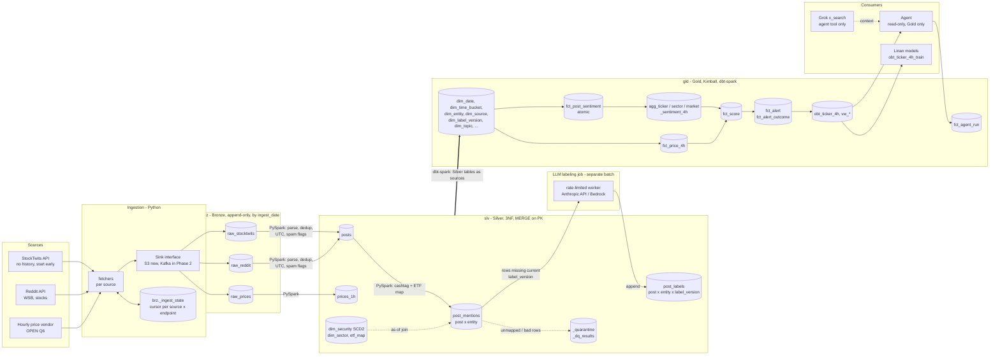
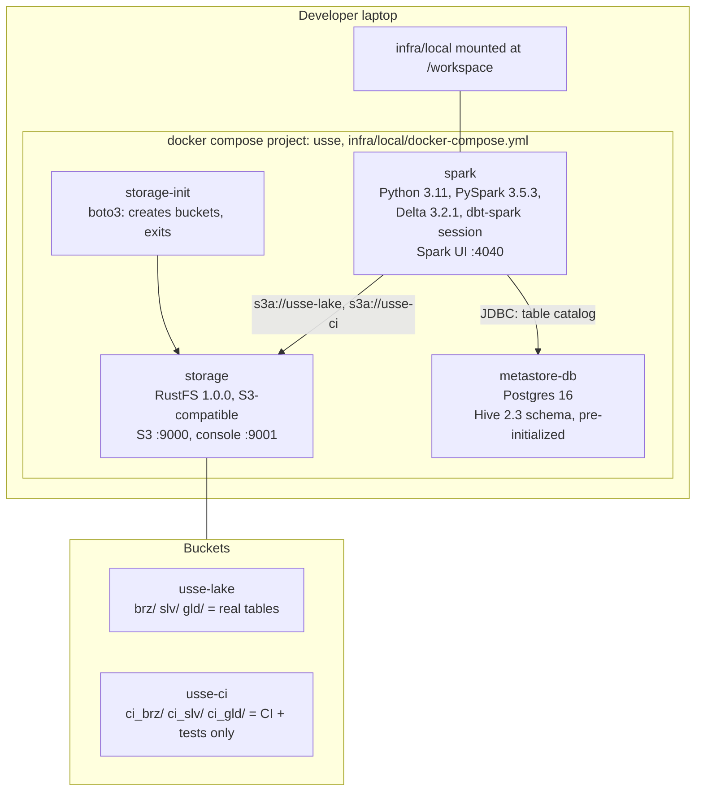
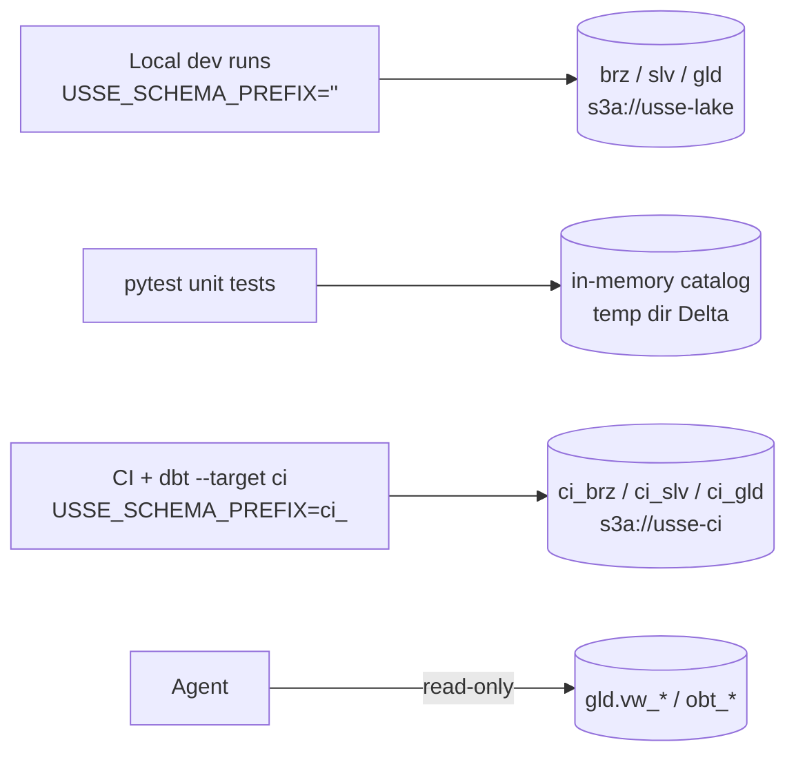
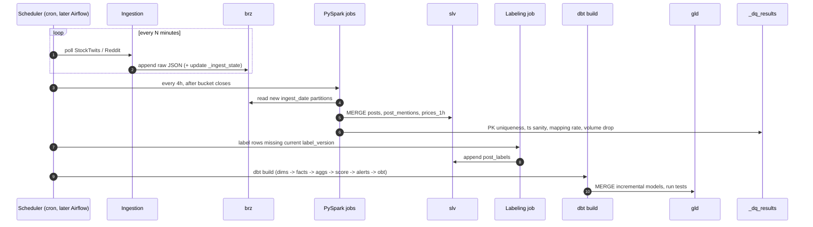

# Data Infrastructure Architecture

Companion to `docs/data_platform_plan.md` (the source of truth). This file shows the infra as diagrams.
Diagrams are Mermaid and render on GitHub. Pre-rendered data flow: [`img/data_flow.png`](img/data_flow.png).

## 1. End-to-end data flow (Phase 1)

## 2. Local runtime (docker compose)

| Local component | AWS equivalent (Plan 3.2) | What changes on migration |
|---|---|---|
| RustFS (S3-compatible) | S3 | `fs.s3a.endpoint` + credentials provider |
| Postgres-backed Hive metastore | Glue Data Catalog | catalog config lines in `spark-defaults.conf` |
| `spark` container, `local[*]` | EMR Serverless (Spark 3.5, EMR 7.x) | job submission wrapper |
| Anthropic API | Bedrock | LLM client config in labeling job |
| `docker compose` | Terraform | new `infra/` module |

## 3. Environment isolation

## 4. Daily batch sequence (target state, Phase 1)

