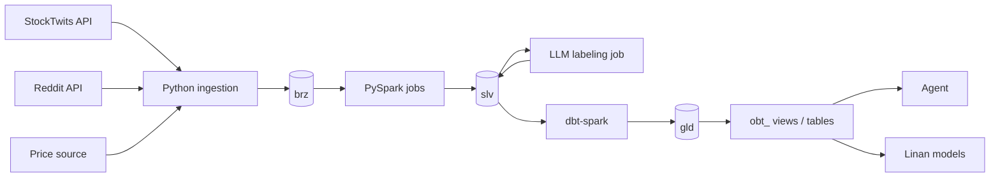

# US-Stock Retail Sentiment Platform — Data Plan

Version: v1.1 (2026-10-10). v1.1 syncs the doc with the local stack as built: RustFS replaces MinIO, the metastore is set up, the repo layout is fixed, and ingestion moves up in the development order
Owner: Jerry (data infrastructure)
Audience: team members (Linan, Jaylen) and their coding agents

Related: `docs/architecture.md` (diagrams), `docs/dev_plan.md` (milestones, workflow), `docs/deltaprinciples.md` (Delta concepts, daily workflow, EMR path), `infra/local/README.md` (run the stack).

This document is the single source of truth for the data layer. Coding agents working on this repo must follow the rules in Section 2 and Section 11. Items marked **OPEN** are not decided yet; do not implement them without confirmation.

## 1. Purpose and Scope

### 1.1 What we are building

Turn unstructured retail-investor discussion (social media posts) into **backtestable, point-in-time correct signals** at three grains (market, sector, ticker), and use an agent to **explain** rule-triggered alerts in plain language.

Core principle: **rules decide, the agent explains.** Alerts are triggered by explicit, versioned, backtestable rules. The agent never makes the trading or alert decision.

### 1.2 Problems this solves

| Problem | Our approach |
|---|---|
| Retail sentiment is text, not data | LLM labels each post (entity, sentiment, stance, topic); labels are aggregated into metrics |
| Feeding raw text to an agent is not reproducible or backtestable | Structured labels + rule-based alerts; agent only explains |
| Free data causes look-ahead bias | Three timestamps per record; features only use data available at decision time |
| LLM labels change when prompts change | Every label carries a `label_version`; versions coexist |
| One post can mention several tickers with opposite views | Labels are stored per post × entity, not per post |

### 1.3 Current phase vs later phases

| Phase | Scope | Status |
|---|---|---|
| **Phase 1 (current)** | StockTwits + Reddit posts → labels → 4h metrics at market / sector / ticker grain → score → alerts + agent explanation; hourly prices for evaluation | In progress |
| Phase 2 | Historical tick replay (introduces Kafka), panic index (VIX, term structure), policy uncertainty (EPU), Trump post event study | Planned |
| Phase 3 | Paper trading (Alpaca), PnL evaluation | Planned |

Kafka is **not** used in Phase 1. Data arrives by polling APIs at low volume; batch processing is sufficient.

### 1.4 Team ownership

| Member | Area | Owns (folders) |
|---|---|---|
| Jerry | Ingestion, storage, Bronze/Silver/Gold pipelines, data quality, infra, CI/CD | `infra/`, `.github/`, `docs/` (except where noted) |
| Linan | Label schema design (with Jaylen), score and alert rule design, model training, validation | `modeling/`, `labeling/schema/`, `labeling/prompts/` (with Jaylen), `infra/local/dbt/models/gld/scoring/`, `infra/local/dbt/models/gld/alerting/` |
| Jaylen | Topic taxonomy, LLM label spot checks, investment hypotheses, review of results | `research/`, `labeling/taxonomy/`, `labeling/spot_checks/` |

Work is modular by folder. Each top-level module has a `README.md` stating its owner, contents and interfaces. The interfaces between modules are **table contracts** (Bronze/Silver YAML, Gold dbt YAML) and the files in `labeling/`. Nobody reaches into another module's internals.

## 2. Design Principles (mandatory)

| # | Principle | Rule |
|---|---|---|
| P1 | Declare grain first | Every table states "one row = ..." in its contract before any code is written |
| P2 | Three timestamps | Keep `created_ts` (event time at source), `ingest_ts` (first time we received it), and where relevant `available_ts` (earliest time usable for a decision). All timestamps stored in UTC |
| P3 | Point-in-time | Any feature, score or alert computed for time T may only use rows with `ingest_ts` / `available_ts` <= T |
| P4 | Immutable Bronze | Bronze is append-only and never modified; Silver/Gold must be fully rebuildable from Bronze |
| P5 | Versioned labels and rules | LLM labels carry `label_version`; scores carry `score_version`; alerts carry `rule_id` + version. New versions are appended, never overwrite old ones |
| P6 | Idempotent writes | All Silver/Gold writes use MERGE on the primary key; re-running a job must not create duplicates |
| P7 | LLM classifies content only | The LLM labels what a post says (entity, sentiment, stance, topic). It must never predict market impact (prevents look-ahead leakage from model training data) |
| P8 | Rules decide, agent explains | Alerts come from explicit rules; the agent only generates explanations |
| P9 | Agent reads Gold only | The agent queries Gold views / OBT through read-only access; never Bronze or Silver |
| P10 | Additive measures | Store sums and counts, not averages or ratios, in fact tables (see Section 7.5) |
| P11 | No LLM calls inside Spark per row | LLM labeling is a separate, rate-limited batch job; results are written to a table, then joined by Spark |
| P12 | Quarantine, don't drop | Records that fail parsing or mapping go to `_quarantine` with a reason |

## 3. Architecture and Tooling

### 3.1 Tool responsibilities

| Stage | Tool | Notes |
|---|---|---|
| Ingestion → Bronze | Python scripts | Pull from APIs; write raw JSON. Output interface is decoupled so the sink can later switch from S3 files to Kafka without changing the fetch logic |
| Bronze → Silver | PySpark | JSON parsing, cleaning, dedup, cashtag extraction, as-of joins |
| LLM labeling | Separate Python batch job | Anthropic API (local) / Amazon Bedrock (AWS); controlled concurrency and retries |
| Silver → Gold | dbt (`dbt-spark` adapter) | Kimball dimensional models, tests, contracts, docs, lineage |
| Query | Spark SQL locally; Athena on AWS | **Athena is query-only.** Athena cannot write Delta tables, so dbt must run on Spark, not `dbt-athena` |
| Table format | Delta Lake | Open format; readable by EMR, Databricks, Athena |
| Orchestration | Simple scripts first; Airflow (local Docker) or Step Functions later | |

### 3.2 Environments

| Item | Local (now) | AWS (later) |
|---|---|---|
| Spark | Docker (`infra/local`): PySpark 3.5.3 + Delta 3.2.1, `local[*]` | EMR 7.x / EMR Serverless (Spark 3.5, Delta 3.x) |
| Object storage | RustFS 1.0 (S3-compatible), buckets `usse-lake` + `usse-ci` | S3 |
| Catalog | Hive metastore on Postgres 16 (official Hive 2.3 schema) | AWS Glue Data Catalog |
| dbt | dbt-spark, `session` method, targets `dev` / `ci` | dbt-spark on EMR |
| LLM | Anthropic API | Amazon Bedrock |
| IaC | `docker compose` | Terraform (`infra/aws`, later) |

All paths use `s3a://`, so moving local storage to S3 is a config change only (`spark.hadoop.fs.s3a.endpoint` + credentials provider in `spark-defaults.conf`).

Local notes:
- **MinIO is not used.** Its public Docker images are no longer available. SeaweedFS was rejected because it keeps real empty directories after deletes, which breaks Delta `CREATE TABLE` at a reused location. RustFS has pure object semantics like S3.
- **The metastore schema is pre-created** from `infra/local/docker/metastore/*.sql`. DataNucleus `autoCreateAll` deadlocks on Postgres and must stay disabled.
- Spark/Delta versions are pinned to match EMR 7.x. Do not upgrade to Spark 4 / Delta 4 without checking EMR support.

Single environment for now. CI and tests write to a **separate bucket and schemas** so test runs never touch real tables:

| | Real | CI / tests |
|---|---|---|
| `USSE_LAKE_ROOT` | `s3a://usse-lake` | `s3a://usse-ci` |
| `USSE_SCHEMA_PREFIX` | `""` → `brz`, `slv`, `gld` | `ci_` → `ci_brz`, `ci_slv`, `ci_gld` |
| dbt target | `dev` | `ci` |
| pytest unit tests | — | in-memory catalog + temp dir, no S3 |

Layer schemas are created only by `python -m usse.bootstrap` at `<lake_root>/<schema>`. Tables inherit their location from the schema; never hard-code a `LOCATION`. A dev environment can later be created with Delta `SHALLOW CLONE`.

### 3.3 Data flow



### 3.4 Repository layout (where things live)

```
docs/                               design docs (this file, architecture.md, dev_plan.md)    [Jerry]
.github/workflows/ci.yml            CI (GitHub requires repo root); runs inside infra/local  [Jerry]
labeling/                           label spec: taxonomy, output schema, prompts, spot checks [Linan + Jaylen]
modeling/                           score/alert rule specs, training, validation              [Linan]
research/                           hypotheses, result reviews                                [Jaylen]
infra/local/                                                                                  [Jerry]
  docker-compose.yml, docker/       local stack (storage, metastore, Spark image)
  .env.example                      copy to .env
  contracts/<layer>/<table>.yml     Bronze/Silver table contracts (P1, Rule 1)
  seeds/                            reference CSVs: security master, sectors, ETF map
  src/usse/                         Python package
    settings.py, spark.py           env-driven config, SparkSession factory
    bootstrap.py                    creates brz/slv/gld schemas
    ingestion/                      API fetchers, sink interface, _ingest_state
    jobs/brz/, jobs/slv/            PySpark jobs, one module per table
    labeling/                       LLM labeling batch job
    dq/                             data quality checks -> _dq_results
  dbt/models/gld/                   Gold models (.sql) + contracts/tests/docs (.yml)
    scoring/, alerting/             fct_score, fct_alert, ... [Linan; Jerry reviews]
  tests/                            pytest
  notebooks/                        JupyterLab exploration only (runs in the spark container)
  scripts/                          one-off / smoke scripts
```

| What you are defining | Where | Format |
|---|---|---|
| Table design (grain, purpose, rules) | this file, §6–§8 | prose + tables |
| Bronze / Silver table schema | `infra/local/contracts/<layer>/<table>.yml` | contract YAML (template: `contracts/_template.yml`) |
| Bronze / Silver transform logic | `infra/local/src/usse/jobs/<layer>/<table>.py` | PySpark |
| Gold table schema | `infra/local/dbt/models/gld/<group>/_<group>.yml` | dbt YAML, `contract: enforced` |
| Gold transform logic | `infra/local/dbt/models/gld/<group>/<model>.sql` | dbt SQL |
| Silver tables visible to dbt | `infra/local/dbt/models/gld/_sources.yml` | dbt sources |
| Reference data | `infra/local/seeds/*.csv` | CSV |
| Topic taxonomy, label schema, prompts | `labeling/` | YAML / JSON schema / Markdown |
| Score / alert rule specs | `modeling/rules/` | YAML / Markdown, implemented in `gld/scoring`, `gld/alerting` |

## 4. Naming Conventions

### 4.1 Schemas (layers)

| Schema | Layer |
|---|---|
| `brz` | Bronze |
| `slv` | Silver |
| `gld` | Gold |

Do not repeat the layer in table names (use `gld.fct_post_sentiment`, not `gld.gld_fct_post_sentiment`).

### 4.2 Table prefixes

| Prefix | Meaning | Layer |
|---|---|---|
| `raw_` | Raw source data | brz |
| (none) | Cleaned entity tables, e.g. `posts` | slv |
| `dim_` | Dimension | slv (reference) / gld |
| `fct_` | Fact table (transaction or atomic) | gld |
| `agg_` | Periodic snapshot / aggregate fact | gld |
| `obt_` | One Big Table, derived only | gld |
| `vw_` | View exposed to the agent | gld |
| `_` | Internal / operational (`_ingest_state`, `_quarantine`, `_dq_results`) | any |

### 4.3 Column conventions

| Pattern | Meaning |
|---|---|
| `snake_case` | All columns |
| `*_ts` | Timestamp, UTC |
| `*_date` | Date |
| `*_id` | Natural / source key |
| `*_key` | Surrogate key (Gold dimensions) |
| `*_hash` | Hashed identifier |
| `*_count`, `*_sum` | Additive measures |
| `is_*`, `has_*` | Boolean |

## 5. Data Sources

| Source | Use | Notes |
|---|---|---|
| StockTwits public API | Phase 1 posts | Free; **no history** (latest messages only), so start ingestion as early as possible. Includes user-set bullish/bearish tag |
| Reddit API | Phase 1 posts (e.g. r/wallstreetbets, r/stocks) | Non-commercial free tier; confirm rate limits |
| xAI API `x_search` (Grok) | **Agent tool only** for qualitative context | Returns Grok's synthesized answer + citation URLs, not raw posts; incomplete and non-reproducible. **Never** used to build backtestable metrics |
| Rednote (Xiaohongshu) | Not used | No API; scraping violates ToS and raises privacy-law risk |
| Hourly prices for tickers + market ETFs (SPY, QQQ) + sector ETFs (e.g. SOXX, XLK) | Evaluation, price features | **OPEN**: vendor to confirm |

## 6. Bronze Layer (`brz`)

Rules: append-only, no parsing beyond extracting keys, duplicates allowed, partitioned by `ingest_date`.

| Table | Grain | Columns |
|---|---|---|
| `raw_stocktwits` | One API record | `payload` (raw JSON string), `source_post_id`, `ingest_ts`, `batch_id`, `api_endpoint`, `ingest_date` |
| `raw_reddit` | One API record | same as above + `subreddit` |
| `raw_prices` | One raw bar | vendor fields as-is, `ingest_ts`, `batch_id`, `ingest_date` |
| `_ingest_state` | One source × endpoint | `source`, `endpoint`, `last_cursor`, `last_run_ts`, `status` |

`_ingest_state` lets ingestion resume from the last cursor after a restart.

## 7. Silver Layer (`slv`)

Silver is entity-centric and normalized (close to 3NF). It answers "what the data is."

### 7.1 `posts` — one row per unique post

| Column | Type | Notes |
|---|---|---|
| `post_id` | string | PK = `source` + `source_post_id` |
| `source` | string | stocktwits / reddit |
| `channel` | string | subreddit; null for StockTwits |
| `author_hash` | string | hashed author ID; raw ID never stored |
| `created_ts` | timestamp | UTC |
| `ingest_ts` | timestamp | first time received |
| `text` | string | cleaned body |
| `lang` | string | |
| `likes`, `replies` | int | snapshot at latest ingest |
| `parent_id` | string | reply parent |
| `user_sentiment_tag` | string | StockTwits user tag; used to sanity-check LLM labels |
| `is_suspected_spam` | boolean | flagged by rules, not deleted |

Processing: dedup by `post_id` keeping the latest version for mutable fields but the **earliest** `ingest_ts`; normalize to UTC; rule-based spam flags (same text from many authors, link-only posts); MERGE on `post_id`.

### 7.2 `post_mentions` — one row per post × entity (bridge table)

| Column | Notes |
|---|---|
| `post_id` | |
| `entity_type` | ticker / sector / market |
| `entity_id` | FIGI for tickers; sector code for sectors; `US_MARKET` for market |
| `mention_method` | `cashtag` / `etf_map` / `llm` |
| `confidence` | 1.0 for rule-based |

Two-step detection: (1) rules — cashtag regex, ETF map (SPY → `US_MARKET`, SOXX → semiconductors); (2) LLM — posts without cashtags that discuss the market or a sector.

Ticker → FIGI mapping uses an **as-of join** on `dim_security` (`created_ts` between `valid_from` and `valid_to`), never today's mapping. Unmapped cashtags go to `_quarantine`.

### 7.3 `post_labels` — one row per post × entity × label_version

| Column | Notes |
|---|---|
| `post_id`, `entity_type`, `entity_id` | matches a row in `post_mentions` |
| `label_version` | model + prompt version |
| `sentiment` | -1 to 1 |
| `stance` | bull / bear / neutral |
| `topic` | from Jaylen's taxonomy (earnings, macro, technical, rumor, ...) |
| `confidence` | |
| `labeled_ts` | |

Produced by the separate labeling job. Incremental: only rows without a label for the current version. A new prompt version re-labels history and appends; old versions remain.

### 7.4 Reference data

| Table | Grain | Notes |
|---|---|---|
| `dim_security` | One security × validity period | `figi`, `ticker`, `name`, `sector_code`, `valid_from`, `valid_to`; SCD2 for ticker and sector changes |
| `dim_sector` | One sector | `sector_code`, `sector_name`, `sector_etf`. **OPEN**: GICS level 1 or custom taxonomy |
| `etf_map` | One ETF | ETF → sector or `US_MARKET` |

### 7.5 `prices_1h` — one row per symbol × hour

`symbol`, `figi`, `bar_ts`, `open`, `high`, `low`, `close`, `volume`. Tickers, sector ETFs and market ETFs in one table.

### 7.6 Operational tables

| Table | Content |
|---|---|
| `_quarantine` | Failed records with `reason`, `source_table`, `ingest_ts` |
| `_dq_results` | Per-run checks: PK uniqueness, timestamp sanity (`created_ts` <= `ingest_ts`), ticker mapping rate, posts-per-hour volume drop per source |

## 8. Gold Layer (`gld`) — Kimball Dimensional Model

Gold answers "how the data is used." Built with dbt following the Kimball four steps. Gold dimensions use surrogate keys.

### 8.1 Step 1 — Business processes

| Process | Description |
|---|---|
| Retail discussion | Posts and sentiment about tickers, sectors, market |
| Price movement | Prices of tickers, sector ETFs, market ETFs |
| Scoring | Score per entity per time bucket |
| Alerting | Alert triggers and their after-the-fact outcomes |

### 8.2 Step 2 — Grain (one grain per fact table)

| Table | Type | Grain |
|---|---|---|
| `fct_post_sentiment` | Transaction (atomic) | One post × one entity × one label_version |
| `agg_ticker_sentiment_4h` | Periodic snapshot | One ticker × one 4h bucket × one source × one label_version |
| `agg_sector_sentiment_4h` | Periodic snapshot | One sector × one 4h bucket × one source × one label_version |
| `agg_market_sentiment_4h` | Periodic snapshot | Market × one 4h bucket × one source × one label_version |
| `fct_price_4h` | Periodic snapshot | One symbol × one 4h bucket |
| `fct_score` | Periodic snapshot | One entity × one 4h bucket × one score_version |
| `fct_alert` | Transaction | One triggered alert |
| `fct_alert_outcome` | Accumulating / after-the-fact | One alert (forward returns computed later) |
| `fct_agent_run` | Transaction | One agent run |

All three sentiment aggregates are computed from `fct_post_sentiment`, so definitions stay consistent. Changing the bucket size later only requires re-aggregating from the atomic fact.

**Sector rollup rule**: a post mentioning several tickers in the same sector counts **once** for that sector (count distinct `post_id`). Same rule for market.

### 8.3 Step 3 — Dimensions

| Dimension | Content | Conformed |
|---|---|---|
| `dim_date` | date, is_trading_day, weekday | Yes |
| `dim_time_bucket` | 4h bucket start/end, session flags (pre-market / regular / after-hours / closed) | Yes |
| `dim_entity` | One row per ticker / sector / market: `entity_type`, `security_key`, `sector_key` | Yes |
| `dim_security` | SCD2, synced from Silver with surrogate key | Yes |
| `dim_sector` | | Yes |
| `dim_source` | source + channel | |
| `dim_label_version` | model, prompt text, start date | |
| `dim_topic` | Jaylen's taxonomy | |
| `dim_score_model` | score_version, component weights, method | |
| `dim_alert_rule` | rule_id, version, thresholds, window | |

**OPEN**: 4h bucket alignment. Proposal: US/Eastern buckets aligned to midnight (00–04, 04–08, 08–12, 12–16, 16–20, 20–24). 08–12 spans pre-market and the open; `dim_time_bucket` session flags must make this explicit. Confirm before building.

### 8.4 Step 4 — Facts and additivity

| Measure | Additivity | Storage |
|---|---|---|
| `post_count` | Additive | store directly |
| Average sentiment | Non-additive | store `sentiment_sum` + `post_count`; divide at query time |
| Bull ratio | Non-additive | store `bull_count`, `bear_count` + `post_count` |
| `unique_authors` | Non-additive (distinct count) | compute separately per grain; document it |
| z-scores | Non-additive | compute in the scoring layer, not in aggregates |

### 8.5 Bus matrix

| Process | dim_date | dim_time_bucket | dim_entity | dim_source | dim_label_version | dim_topic | dim_score_model | dim_alert_rule |
|---|---|---|---|---|---|---|---|---|
| Retail discussion | ✓ | ✓ | ✓ | ✓ | ✓ | ✓ | | |
| Price movement | ✓ | ✓ | ✓ | | | | | |
| Scoring | ✓ | ✓ | ✓ | | ✓ | | ✓ | |
| Alerting | ✓ | ✓ | ✓ | | ✓ | | ✓ | ✓ |

### 8.6 Scoring (`fct_score`)

| Rule | Detail |
|---|---|
| Store components | Total score **plus** each component (sentiment, attention, price momentum, etc.) for attribution and agent explanations |
| Versioned | `score_version` via `dim_score_model` |
| Low-sample handling | Minimum post count, or shrink scores toward neutral for low-volume entities |
| Validation | Rank IC of score vs forward returns, computed in a separate outcome table |
| Point-in-time | `available_ts` on every row |

**OPEN**: what the score means (direction / risk / attention). Each score must have exactly one meaning; multiple scores are allowed. Also confirm the stock universe.

### 8.7 Alerts

- `fct_alert`: `alert_id`, `entity_key`, `triggered_ts`, `rule_key`, snapshot of metric values at trigger time.
- `fct_alert_outcome`: forward returns (e.g. 4h, 1d, 5d) computed after the fact. Kept separate from `fct_alert` so outcomes can never leak into trigger logic.
- `fct_agent_run`: `run_id`, `alert_id`, model, prompt version, tools called, output text, tokens, cost. Agent output is non-reproducible, so every run is logged.

### 8.8 One Big Table (derived)

| Table | Consumer | Content |
|---|---|---|
| `obt_ticker_4h` | Linan (training), agent | ticker, sector name, bucket, session, sentiment metrics, price returns, score + components, alert flag |

Rules for OBTs:

1. Built **only** from Gold facts/dimensions, never directly from Silver.
2. No new business logic; joins and column expansion only.
3. Dimension attributes use the value **valid at that time** (as-of join on SCD2), never the current value.
4. Start as a dbt view; materialize as a table if queries get slow.
5. A training variant may add forward returns as labels; it must be clearly named (e.g. `obt_ticker_4h_train`) and never exposed to the agent.

## 9. Quality, Testing, Contracts, Lineage

| Area | Tool | Scope |
|---|---|---|
| Code tests | pytest | PySpark transformation functions (input → expected output). Unit tests use the in-memory fixture in `tests/conftest.py`; integration tests (`-m integration`) run on the local stack with `ci_` schemas |
| Data tests | dbt tests | PK uniqueness, not null, FK relationships, accepted values / ranges |
| Data quality monitoring | `_dq_results` | Volume drops, mapping rates, timestamp sanity |
| Contracts | dbt model contracts; contract YAML | Gold: `contract: enforced` in dbt model YAML. Bronze/Silver: `infra/local/contracts/<layer>/<table>.yml` |
| Lineage | dbt docs | Silver → Gold automatically; Bronze → Silver documented with a diagram |
| Lint | ruff (Python), sqlfluff (SQL) | |
| CI/CD | GitHub Actions | Now: ruff → pytest → `dbt parse --target ci`. Later: + integration tests and `dbt build --target ci` on sample data (see `docs/dev_plan.md` §1.4) |

## 10. Development Order

Milestones (M*) refer to `docs/dev_plan.md`. Bronze ingestion moves to step 2 because StockTwits has no history.

| Step | Work | Milestone | Status | Why |
|---|---|---|---|---|
| 1 | Local Docker: Spark + S3-compatible storage + metastore + Delta hello world | M0 | **Done** | Foundation (`scripts/smoke_delta.py`) |
| 2 | Bronze ingestion + `_ingest_state`, running on an always-on host | M1 | Next | **Start early**: StockTwits has no history; every day of delay is lost data |
| 3 | `dim_security`, `dim_sector`, `etf_map` | M2 | | Everything downstream depends on universe and sector mapping. The SCD2 loader can be built before Q2/Q3 are decided |
| 4 | `slv.posts` cleaning and dedup | M3 | | |
| 5 | `slv.post_mentions` rule-based part (cashtag + ETF map) + DQ checks | M3 | | No LLM dependency |
| 6 | dbt Gold: dimensions → `fct_post_sentiment` → three `agg_` tables | M4 | | Thin slice to Gold |
| 7 | `slv.post_labels` + LLM market/sector detection | M5 | | After Jaylen finalizes the topic taxonomy |
| 8 | `slv.prices_1h`, `fct_price_4h` | M6 | | After price vendor (Q6) |
| 9 | `fct_score`, `fct_alert`, `fct_alert_outcome` | M6 | | After score meaning is decided |
| 10 | `obt_ticker_4h`, agent views, `fct_agent_run` | M7 | | |
| 11 | Terraform deploy to AWS | M8 | | After local pipeline is green end to end |

Get one thin slice working Bronze → Gold before polishing any single layer.

## 11. Rules for Coding Agents

1. Read the table's contract (grain, keys, columns) before writing code for it; if no contract exists, write one first (`infra/local/contracts/<layer>/<table>.yml` for Bronze/Silver, dbt model YAML for Gold). See §3.4 for where things live.
2. Never modify Bronze data or write to Bronze from transformation jobs.
3. All Silver/Gold writes are MERGE on the declared primary key.
4. Never call an LLM inside a Spark transformation; use the labeling job.
5. Never use the LLM to predict price impact; content classification only.
6. Use as-of joins on SCD2 dimensions; never join on current values for historical rows.
7. Store additive measures (sums, counts); no stored averages or ratios in fact tables.
8. No business logic in `obt_` tables.
9. All timestamps in UTC; bucket conversion to US/Eastern happens only in Gold.
10. Follow naming conventions in Section 4 exactly.
11. CI and tests write to the CI target only.
12. Do not implement anything marked **OPEN** without confirmation from Jerry.
13. Code comments in English.
14. Get schema names and locations from `usse.settings` (`schema("slv")`, `location("slv")`); never hard-code `brz`/`slv`/`gld` or `s3a://` paths in job code.
15. Before opening a PR that touches jobs, run `scripts/smoke_delta.py` and `pytest` inside the local stack.
16. Every table is Delta. Always write `USING DELTA` explicitly (or `.format("delta")`). `spark.sql.sources.default=delta` is a safety net, not a substitute. Never create Hive, Parquet or CSV tables in `brz`/`slv`/`gld`.
17. Bronze/Silver DDL comes from the table's contract YAML; never hand-write a `CREATE TABLE` that differs from its contract. Schema changes go through the contract first, then `ALTER TABLE`. Gold DDL is generated by dbt from the model and its contract.
18. Work stays inside your module (§1.4). To change another module's files or a contract it owns, open a PR and request that owner's review. A coding agent works only within the folders of the person it is working for.
19. Each module's `README.md` is its interface doc. Update it in the same PR when a module's inputs/outputs change.
20. Notebooks (`infra/local/notebooks/`) are for exploration only. Production code is `.py` under `src/usse/` with tests; nothing in production imports from a notebook. Clear notebook outputs before committing.

## 12. Key Design Decisions (summary)

| Decision | Choice | Reason |
|---|---|---|
| Kafka in Phase 1 | No | Polling API, low volume, 4h buckets; batch is enough. Introduce at replay / alert-fanout stage |
| Bronze → Silver tool | PySpark | Complex parsing, regex, as-of joins; shows Spark depth |
| Silver → Gold tool | dbt-spark | Modeling, tests, contracts, lineage where they matter most |
| Compute | EMR (not Databricks) | Goal is AWS experience; Delta keeps Databricks as a future option |
| Label grain | post × entity × version | One post can hold opposite views on different tickers |
| Three grains | Separate aggregate tables from one atomic fact | Kimball: one grain per fact table; consistent definitions |
| OBT | Coexists with star schema, downstream only | Star = source of truth; OBT = convenience for agent and ML |
| X data | Grok `x_search` as agent tool only | Not raw, not complete, not reproducible |
| Environments | Single env now, CI isolated (`usse-ci` bucket + `ci_` schemas) | Sufficient for team size; clone dev later |
| Local object storage | RustFS (not MinIO, not SeaweedFS) | MinIO images unavailable; SeaweedFS directory semantics break Delta |
| Local catalog | Hive metastore on Postgres, schema pre-initialized | Shared across sessions like Glue; auto-create deadlocks |
| Versions | Spark 3.5.3 + Delta 3.2.1 | Matches EMR 7.x so code runs unchanged on AWS |
| Order | Bronze ingestion before reference data | StockTwits has no history |
| Notebooks | JupyterLab inside the spark container, not on the host | Same Spark/Delta/config as jobs; Spark on Windows hosts needs fragile Hadoop native binaries |

## 13. Open Questions

| # | Question | Owner |
|---|---|---|
| Q1 | Score meaning: direction, risk, or attention (or multiple scores)? | Jaylen + Linan |
| Q2 | Stock universe (e.g. semiconductors, S&P 100)? | Linan + Jaylen |
| Q3 | Sector taxonomy: GICS level 1 or custom? | Jerry + Jaylen |
| Q4 | 4h bucket alignment and timezone | Jerry + Linan |
| Q5 | Topic taxonomy for `post_labels.topic` | Jaylen |
| Q6 | Price data vendor for hourly bars | Jerry |
| Q7 | Reddit subreddits to include | Jaylen |
| Q8 | AWS account + budget for an always-on ingestion host (needed for step 2) | Jerry |
| Q9 | Bootstrap `label_version = user_tag_v0` from StockTwits user tags, so the Gold thin slice can run before LLM labels exist | Jerry + Linan |
