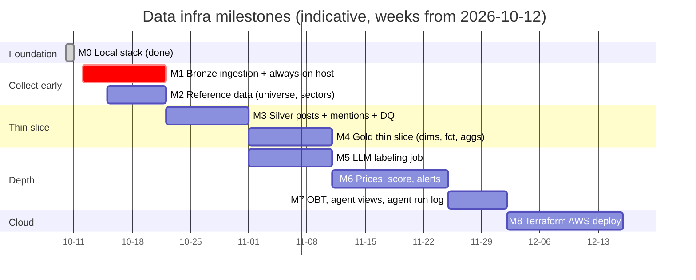

# Data Infrastructure — Development Plan

Version: v1 (2026-10-10) · Owner: Jerry · Scope: data infra only (plan §1.4, Jerry's area)

`docs/data_platform_plan.md` is the source of truth for **what** to build. This document covers **how and in what order**: milestones, the per-table workflow, the git/CI process, and which open questions block which work. Diagrams are in `docs/architecture.md`.

---

## 0. Where we are

| Item | Status |
|---|---|
| Local stack (Plan §10 step 1) | **Done.** `docker compose up -d --build` brings up storage + metastore + Spark workspace; `scripts/smoke_delta.py` passes (also on re-runs); pytest 4/4, ruff clean, `dbt debug` connection OK |
| Repo skeleton | Everything under `infra/local/` (stack, `src/usse/`, `tests/`, `dbt/`, `contracts/`); `docs/` and `.github/` at repo root |
| Deviation from plan | **MinIO → RustFS.** Public MinIO Docker images are no longer pullable. RustFS 1.0 (Apache-2.0, MinIO-compatible) replaces it; paths are still `s3a://`, so the AWS migration is unchanged. SeaweedFS was tried first and rejected: it keeps real empty directories after deletes, which breaks Delta `CREATE TABLE` at a reused location. Recorded in plan §3.2 and §12 |
| Metastore setup | Postgres is pre-initialized with the official Hive 2.3 schema (`docker/metastore/`). DataNucleus `autoCreateAll` **deadlocks** on Postgres during the first `CREATE TABLE`, so it is disabled |

### Repo layout

See `docs/data_platform_plan.md` §3.4 for the full tree and a "what goes where" table. In short: design → `docs/`; Bronze/Silver schemas → `infra/local/contracts/`; Silver logic → `infra/local/src/usse/jobs/`; Gold schema + logic → `infra/local/dbt/models/gld/`. Paths below are relative to `infra/local/` unless they start with `docs/` or `.github/`.

---

## 1. Working agreement

### 1.1 Git and review

- **Modular ownership** (Plan §1.4): `infra/` Jerry · `modeling/` + `gld/scoring`, `gld/alerting` Linan · `research/` Jaylen · `labeling/` Linan + Jaylen. When GitHub handles are known, add `.github/CODEOWNERS` so PRs auto-request the owning module's reviewer.

- **Trunk-based.** `main` is always green. Short-lived branches: `feat/<table-or-area>`, `fix/...`, `chore/...`.
- One PR = one table or one coherent piece of infra. Rough size limit ~400 lines of non-generated diff.
- PR needs green CI + one reviewer. Schema/contract changes need review from the table's consumer (e.g. `post_labels` → Linan + Jaylen).
- Conventional commits (`feat(slv.posts): ...`, `fix(dq): ...`).
- Nothing marked **OPEN** in the plan gets merged without Jerry's sign-off (Plan §11 rule 12). If a milestone needs an OPEN decision, the PR description links the resolved question.

### 1.2 Per-table workflow (contract-first loop)

Every new table, Bronze through Gold, goes through the same steps. Coding agents follow this exactly.

| # | Step | Output | Gate |
|---|---|---|---|
| 1 | **Contract.** Grain ("one row = ..."), PK, columns + types, partitioning, upstreams, P2 timestamps involved | `contracts/<layer>/<table>.yml` (Bronze/Silver; copy `contracts/_template.yml`) or dbt model YAML with `contract: enforced` (Gold) | Reviewed before code |
| 2 | **Sample fixtures.** 5–20 hand-written input rows covering edge cases (dupes, late arrivals, unmapped tickers, multi-ticker posts) | `tests/fixtures/<table>/` | — |
| 3 | **Failing tests.** Pure transform function: input DataFrame → expected DataFrame | `tests/jobs/test_<table>.py` | Must fail first |
| 4 | **Transform.** Pure function in `src/usse/jobs/<layer>/<table>.py`; I/O in a thin `run()` | code | Unit tests green |
| 5 | **Write path.** MERGE on PK (P6); quarantine failures (P12) | code | Re-run gives same row count |
| 6 | **DQ checks.** Add the table's checks to `_dq_results` (PK unique, ts sanity, volume) | `src/usse/dq/` | — |
| 7 | **Integration run.** Against the local stack with `USSE_SCHEMA_PREFIX=ci_` | `pytest -m integration` | Green |
| 8 | **Docs.** Lineage note for Bronze → Silver; dbt docs for Gold | `docs/` / dbt YAML | — |

Contract template: `contracts/_template.yml`. Worked example: `contracts/brz/raw_stocktwits.yml`.

### 1.3 Testing pyramid

| Level | Where it runs | What it covers |
|---|---|---|
| Unit (pytest) | laptop / CI, in-memory catalog + temp dir (`tests/conftest.py`) | Transform functions, parsing, cashtag regex, as-of join logic, bucket math |
| Integration (`pytest -m integration`) | local stack, `ci_` schemas on `usse-ci` | End-to-end job runs: Bronze fixture → Silver tables, MERGE idempotency |
| dbt tests | `dbt build --target ci` | PK unique, not null, relationships, accepted values, contracts |
| DQ monitoring | every production run | `_dq_results`: volume drops, mapping rate, ts sanity |

### 1.4 CI evolution

| Stage | CI steps | Lands in |
|---|---|---|
| Now | ruff → pytest (unit) → `dbt parse --target ci` | M0 (done) |
| + sqlfluff | add `sqlfluff lint dbt/models` (dbt templater) | M4, when the first Gold model exists |
| + dbt build | job builds the Spark image, seeds sample Silver into `ci_slv`, runs `dbt build --target ci` | M4 |
| + integration | same job runs `pytest -m integration` against the compose stack | M3 |
| + deploy | on merge to `main`: build/push job image, `terraform plan` / apply | M8 |

---

## 2. Milestones

The order follows Plan §10 with one change: **Bronze ingestion moves to the front** because StockTwits has no history, so every day without ingestion is data we lose for good. Plan §10 also says to get a thin slice through to Gold before polishing any one layer; M4 is that slice.



### M0 — Local stack ✅ (Plan step 1)

Delivered: compose stack, Spark image (PySpark 3.5.3 + Delta 3.2.1, matches EMR 7.x), Postgres-backed metastore (Glue stand-in), `usse.bootstrap` creating `brz/slv/gld`, smoke test (Delta MERGE idempotency, time travel, cross-session catalog), dbt project with `dev` / `ci` targets, CI workflow.

### M1 — Bronze ingestion, running 24/7 (Plan step 3) — **critical path**

**Goal:** StockTwits + Reddit raw records landing in `brz` continuously, resumable after restarts.

Deliverables:
- `src/usse/ingestion/sink.py`: a `Sink` protocol with `write(records, source, endpoint, batch_id)`. First implementation `S3JsonSink` writes newline-delimited JSON to `<lake>/brz/raw_<source>/ingest_date=YYYY-MM-DD/<batch_id>.jsonl`. This is the interface that later lets us swap in Kafka (Plan §3.1).
- `src/usse/tables.py`: `ensure_table(contract_path)` reads a contract YAML and runs `CREATE TABLE IF NOT EXISTS <prefix><layer>.<table> (...) USING DELTA [PARTITIONED BY ...]`. This keeps contracts as the single source of truth for Bronze/Silver schemas (Plan Rule 17). Unit test: contract → expected DDL string.
- `src/usse/ingestion/state.py`: read/write `_ingest_state` (source × endpoint → `last_cursor`, `last_run_ts`, `status`).
- `src/usse/ingestion/stocktwits.py`, `reddit.py`: fetchers that only fetch. Each record is wrapped with `source_post_id`, `ingest_ts` (UTC, our clock), `batch_id`, `api_endpoint`.
- Bronze Delta tables `brz.raw_stocktwits` / `raw_reddit` created over the landing path. Alternative: a small Spark job that appends landed JSONL into Delta. Pick one in the M1 PR; the recommendation is a **Spark append job**, so Bronze is Delta while ingestion stays a lightweight Python process with no JVM.
- Rate limiting + backoff per source; structured logs.

**Always-on host.** A laptop cannot ingest 24/7. Recommendation: run ingestion on a small always-on VM (e.g. EC2 t4g.small or Lightsail) that writes **straight to a real S3 bucket** from day one. Only ingestion goes to AWS this early; Spark/dbt stay local and read that bucket. This is the only piece of M8 pulled forward. Needs a decision on the AWS account and budget.

Acceptance:
- Kill the process mid-run and restart it: no gaps beyond one poll interval, duplicates allowed (Bronze rule), cursor resumes.
- `created_ts <= ingest_ts` holds on a 24h sample.
- A daily volume line shows up in logs/metrics.

Blocked by: **Q2 universe** (which symbols to poll on StockTwits) and **Q7 subreddits**. Unblock: start with a provisional broad list (StockTwits trending + a starter list Jaylen/Linan approve) because Bronze is raw and cheap to over-collect. That provisional list itself needs sign-off.

### M2 — Reference data (Plan step 2)

Deliverables: `seeds/security_master.csv`, `seeds/sector.csv`, `seeds/etf_map.csv`; a Spark job loading `slv.dim_security` as SCD2 (`valid_from`, `valid_to`, FIGI key), plus `slv.dim_sector` and `slv.etf_map`. FIGI lookup via the OpenFIGI API, cached in the seed file.

Acceptance: the SCD2 loader applied twice with the same seed is a no-op; a ticker rename (fixture) closes the old row and opens a new one; as-of lookup unit tests pass.

Blocked by: **Q2** (universe contents), **Q3** (GICS L1 vs custom). The SCD2 mechanism can be built and tested on fixture data before these are decided.

### M3 — Silver: posts, mentions, DQ (Plan steps 4, 5, 7-DQ)

Deliverables:
- `slv.posts`: parse both sources, normalize to UTC, `author_hash` (salted SHA-256, salt from env, never stored), dedup keeping **earliest** `ingest_ts` and **latest** mutable fields, spam flags, MERGE on `post_id`.
- `slv.post_mentions` (rule-based part): cashtag regex, ETF map, **as-of join** on `dim_security`; unmapped tickers → `_quarantine`.
- `slv._quarantine`, `slv._dq_results` + checks: PK uniqueness, `created_ts <= ingest_ts`, ticker mapping rate, posts-per-hour drop per source.
- Incremental processing: each run reads only `ingest_date` partitions newer than a watermark kept in a `_job_state` table (same shape as `_ingest_state`).

Acceptance: re-running a day gives identical row counts; a fixture post with `$NVDA $AMD` produces 2 mention rows; a cashtag for an unknown symbol lands in quarantine with a reason; the integration test passes on `ci_` schemas.

### M4 — Gold thin slice (Plan step 8)

Deliverables (dbt): `dim_date`, `dim_time_bucket`, `dim_entity`, `dim_source`, `dim_label_version`, `fct_post_sentiment`, `agg_ticker_sentiment_4h`, `agg_sector_sentiment_4h`, `agg_market_sentiment_4h`. Incremental models use `incremental_strategy: merge` + `unique_key`. Contracts enforced. Sector/market rollups count distinct `post_id`.

To get the slice through before LLM labels exist, a proposal **(needs sign-off)**: a bootstrap `label_version = 'user_tag_v0'` built from the StockTwits `user_sentiment_tag` (bull → +1, bear → −1). This fits P5 (versions coexist) and is replaced once M5 lands.

Acceptance: `dbt build --target ci` green in CI on seeded sample data; sum of `post_count` across tickers ≥ sector `post_count` (distinct rule); no averages stored (P10).

Blocked by: **Q4** (bucket alignment) for `dim_time_bucket`.

### M5 — LLM labeling job (Plan step 6)

Deliverables: `src/usse/labeling/` as a standalone batch job (P11): selects `post_mentions` rows with no label for the current `label_version`, calls Anthropic with bounded concurrency + retries, validates structured output (sentiment ∈ [−1, 1], stance enum, topic ∈ taxonomy), appends to `slv.post_labels`. Prompt + model live in a versioned file; `label_version` = hash of (model, prompt). Includes LLM market/sector detection for posts without cashtags (`mention_method = 'llm'`). Cost logging per run.

Acceptance: re-running labels nothing new; bumping the prompt version re-labels and appends while old versions remain; invalid LLM output goes to quarantine; the prompt contains no market-impact questions (P7). The agreement rate vs `user_sentiment_tag` is reported to Jaylen for spot checks.

Blocked by: **Q5** topic taxonomy.

### M6 — Prices, score, alerts (Plan steps 7, 9)

Deliverables: price ingestion → `brz.raw_prices` → `slv.prices_1h`; `fct_price_4h`; `dim_score_model` + `fct_score` (components stored, `available_ts`, low-sample shrinkage); `dim_alert_rule` + `fct_alert`; `fct_alert_outcome` computed by a separate later job.

Acceptance: point-in-time test (a feature at T never reads rows with `available_ts > T`); `fct_alert_outcome` is never referenced by alert logic (dbt lineage check).

Blocked by: **Q1** score meaning, **Q6** price vendor.

### M7 — OBT, agent views, agent run log (Plan step 10)

Deliverables: `obt_ticker_4h` (dbt view; as-of joins only, no logic), `obt_ticker_4h_train` (adds forward returns, not exposed to the agent), `vw_*` views, a read-only role/user for the agent, `fct_agent_run`.

Acceptance: the agent principal cannot read `brz`/`slv` or `*_train`; OBT row count equals `agg_ticker_sentiment_4h` row count.

### M8 — AWS (Plan step 11)

Deliverables: `infra/` Terraform with S3 buckets (lake, ci), Glue databases, EMR Serverless app, IAM (job role, agent read-only role), scheduler (EventBridge + Step Functions), Bedrock access. Config switch: `spark-defaults` profile for EMR (S3 endpoint, Glue catalog, `DefaultAWSCredentialsProviderChain`).

Acceptance: the same job code runs on EMR with only config changes; `dbt build` runs on EMR; Athena can query Gold Delta tables.

---

## 3. Open questions → what they block

| Q | Decision | Blocks | Needed by |
|---|---|---|---|
| Q2 | Stock universe | M1 symbol list (provisional OK), M2 seed | **Now** |
| Q7 | Subreddits | M1 Reddit fetcher | **Now** |
| Q3 | Sector taxonomy | M2 `dim_sector`, sector aggs | M2 |
| Q4 | 4h bucket alignment | M4 `dim_time_bucket` | M4 |
| Q5 | Topic taxonomy | M5 labeling prompt | M5 |
| Q6 | Price vendor | M6 prices | M6 (start the evaluation in M3) |
| Q1 | Score meaning | M6 `fct_score` | M6 |
| new | AWS account + budget for the always-on ingestion host | M1 | **Now** |
| new | `user_tag_v0` bootstrap label version | M4 thin slice | M4 |

---

## 4. Orchestration path

| Phase | Mechanism |
|---|---|
| M1–M3 | Ingestion as a long-running process (systemd/docker on the VM). Local Spark jobs run by hand or via `scripts/run_pipeline.py` |
| M4–M7 | A single `run_pipeline` entrypoint: Silver jobs → labeling → `dbt build`. Cron every 4h, after the bucket closes |
| M8 | Step Functions (or Airflow if the team prefers its UI) calling EMR Serverless jobs |

Each step stays idempotent (P6), so a scheduler can safely retry any of them.

---

## 5. Risks and mitigations

| Risk | Mitigation |
|---|---|
| StockTwits data lost before ingestion starts | M1 first; always-on host |
| StockTwits / Reddit API access or limits change | Fetchers isolated behind the sink; `_ingest_state` + volume-drop DQ alert surface outages fast |
| Concurrent Delta writers on S3 corrupt the log | One writer job per table; on AWS, enable the DynamoDB LogStore if concurrency is ever needed |
| Look-ahead bias slips in | `available_ts` everywhere; point-in-time unit tests in M6; outcomes in a separate table |
| LLM cost/time when re-labeling history | Batch API, concurrency caps, cost logged per run; re-label only on version bump |
| Local metastore ≠ Glue | Use only standard Spark SQL DDL; no Hive-specific features |
| RustFS ≠ S3 edge cases (RustFS 1.0 is young) | Integration tests run on real S3 once M1's bucket exists; fallback is any S3-compatible server, since only the endpoint config changes |
| Secrets in repo | `.env` git-ignored; on AWS use Secrets Manager / IAM roles |

---

## 6. Next actions (this week)

1. Team: decide **Q2 (provisional list)**, **Q7**, and the AWS account for the ingestion host.
2. Jerry: init the repo, push to GitHub, enable branch protection on `main` with required CI.
3. Jerry: M1 PR #1, sink interface + `_ingest_state` + StockTwits fetcher with fixtures and tests.
4. Jerry: M1 PR #2, Reddit fetcher; deploy ingestion to the always-on host.
5. In parallel: M2 SCD2 loader on fixture data.

---

## 7. Local commands

Run from `infra/local/`:

```bash
cp .env.example .env                       # once
docker compose up -d --build               # start stack
docker compose exec spark python scripts/smoke_delta.py
docker compose exec spark pytest -q        # unit tests
docker compose exec spark ruff check src tests scripts docker
docker compose exec -w /workspace/dbt spark dbt debug
docker compose down                        # stop (volumes persist)
docker compose down -v                     # stop + wipe all local data
```

UIs: RustFS console http://localhost:9001 (login = `S3_ACCESS_KEY` / `S3_SECRET_KEY` from `.env`) · Spark UI http://localhost:4040 (while a job runs).
